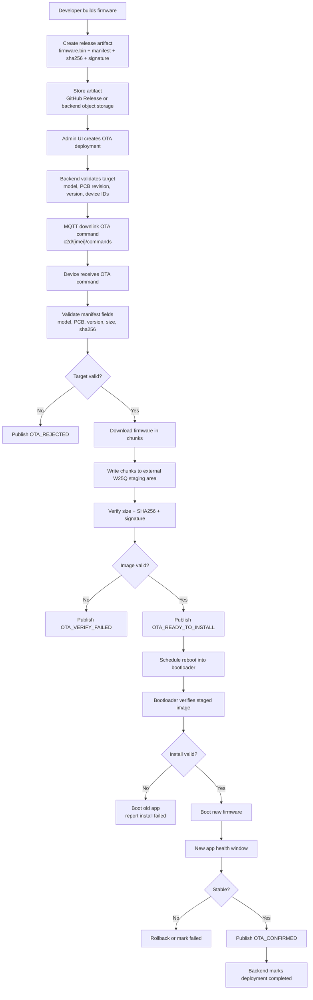

# Powerlytics Embedded OTA Context

This document defines the OTA flow between Admin UI, backend/cloud and STM32 gateway firmware.

## Goals

- OTA must be controlled by admin users only.
- Device owners can view firmware version, OTA status and history, but cannot deploy firmware.
- Start with single-device OTA, then expand to staged rollout after the bootloader and rollback path are proven.
- OTA success must mean the new firmware booted, stayed healthy and explicitly confirmed success.
- Power loss, network loss or bad firmware must not brick the device.

## Recommended High-Level Architecture



## Roles

| Role | OTA Permission |
| --- | --- |
| Admin | Upload firmware, create deployment, target devices, start/pause/cancel rollout |
| Support/Internal | Optional limited OTA for assigned test devices only |
| Device owner | View current version, status and history only |

## Firmware Artifact Manifest

The backend should store a manifest with every release.

```json
{
  "type": "firmware_manifest",
  "schemaVersion": 1,
  "firmwareVersion": "1.0.1",
  "firmwareBuild": "2026-08-02-001",
  "deviceModel": "blackpill-f407-gateway",
  "pcbRevision": "revA",
  "size": 164108,
  "sha256": "hex_sha256_of_bin",
  "signature": "future_signature",
  "artifactUrl": "https://backend.example.com/ota/signed-url"
}
```

For production, devices should not use GitHub credentials directly. The backend should either proxy the artifact download or provide a short-lived signed URL.

## OTA Downlink Command

Send OTA commands on the existing command topic:

```text
c2d/{imei}/commands
```

Payload:

```json
{
  "type": "ota",
  "deploymentId": "ota_2026_08_02_001",
  "firmwareVersion": "1.0.1",
  "firmwareBuild": "2026-08-02-001",
  "deviceModel": "blackpill-f407-gateway",
  "pcbRevision": "revA",
  "artifactUrl": "https://backend.example.com/ota/signed-url",
  "size": 164108,
  "sha256": "hex_sha256_of_bin",
  "signature": "future_signature",
  "force": false,
  "allowDowngrade": false
}
```

## OTA Device Acknowledgements

Publish status updates on:

```text
d2c/{imei}/message
```

Payload:

```json
{
  "type": "ota_ack",
  "deploymentId": "ota_2026_08_02_001",
  "status": "OTA_RECEIVED",
  "stage": "RECEIVE",
  "progress": 0,
  "currentVersion": "1.0.0",
  "targetVersion": "1.0.1",
  "deviceModel": "blackpill-f407-gateway",
  "pcbRevision": "revA",
  "reason": "accepted"
}
```

Expected statuses:

```text
OTA_RECEIVED
OTA_REJECTED
OTA_DOWNLOAD_STARTED
OTA_DOWNLOAD_PROGRESS
OTA_DOWNLOAD_COMPLETE
OTA_VERIFY_OK
OTA_VERIFY_FAILED
OTA_READY_TO_INSTALL
OTA_INSTALL_SCHEDULED
OTA_BOOTED_NEW_VERSION
OTA_CONFIRMED
OTA_DOWNLOAD_FAILED
OTA_INSTALL_FAILED
OTA_ROLLBACK
OTA_TIMEOUT
```

Backend should mark deployment successful only after `OTA_CONFIRMED`.

## Backend Deployment State

Deployment object:

```json
{
  "deploymentId": "ota_2026_08_02_001",
  "createdBy": "admin_user_id",
  "targetDeviceIds": ["device_1"],
  "targetImeis": ["863110085124686"],
  "deviceModel": "blackpill-f407-gateway",
  "pcbRevision": "revA",
  "firmwareVersion": "1.0.1",
  "status": "IN_PROGRESS",
  "rolloutMode": "single_device"
}
```

Per-device OTA state:

```json
{
  "deploymentId": "ota_2026_08_02_001",
  "deviceId": "device_1",
  "imei": "863110085124686",
  "status": "OTA_DOWNLOAD_PROGRESS",
  "progress": 42,
  "currentVersion": "1.0.0",
  "targetVersion": "1.0.1",
  "lastError": null,
  "updatedAt": "2026-08-02T12:00:00Z"
}
```

## Rollout Policy

Initial rollout modes:

1. Single device only.
2. Small manually selected batch.
3. Site/office rollout.
4. Device model/PCB rollout.
5. Percentage rollout.

Do not start with an "all devices" button. It can be added later with guardrails.

## Device-Side Implementation Phases

1. Firmware identity metadata in telemetry/health.
2. OTA command parser and OTA ack publishing.
3. W25Q staging metadata layout.
4. Chunk download and resumable write.
5. SHA256 verification.
6. Bootloader install/swap flow.
7. New app boot confirmation.
8. Rollback/failure handling.

The current firmware change implements phases 1 and the command/ack skeleton of phase 2 only.

## GitHub Actions Firmware Upload

The repository includes a manual workflow:

```text
.github/workflows/upload-firmware-to-gcs.yml
```

Required GitHub Secrets:

```text
GCP_PROJECT_ID
GCP_PROJECT_NUMBER
GCS_BUCKET_NAME
GCP_WORKLOAD_IDENTITY_PROVIDER
GCP_SERVICE_ACCOUNT_EMAIL
```

The workflow uploads the current committed firmware artifacts to:

```text
gs://{GCS_BUCKET_NAME}/firmware/{deviceModel}/{pcbRevision}/{firmwareVersion}/{gitSha}/
```

Uploaded files:

```text
BALCKPILL_BASED_GENERIC_GATEWAY.bin
BALCKPILL_BASED_GENERIC_GATEWAY.hex
BALCKPILL_BASED_GENERIC_GATEWAY.elf
BALCKPILL_BASED_GENERIC_GATEWAY.map
SHA256SUMS
manifest.json
```

The backend should generate a signed URL for the `.bin` file and include that
URL in the OTA downlink command as `artifactUrl`.
